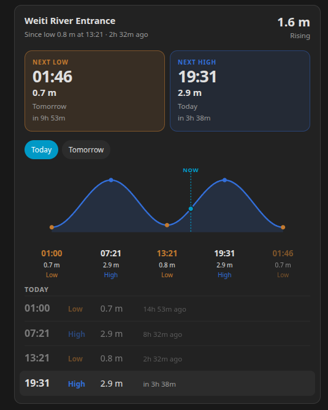
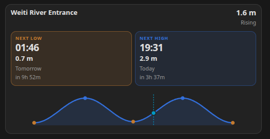
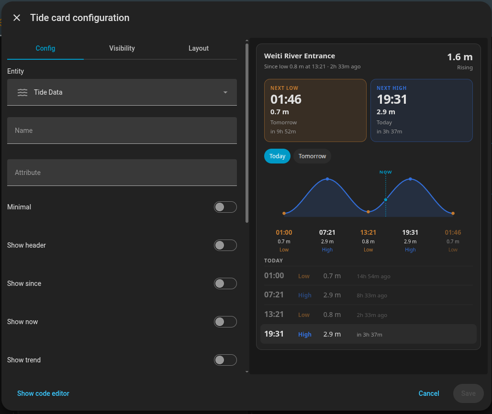

# ha-tide-card

Lovelace card that draws a tide wave from a [tide-card/v1](SPEC.md) document. It does not know which service produced the tides.

The card shows:

- estimated height right now, and whether the water is rising or falling
- the next low and the next high, with a 24-hour clock, the height, and how long until then
- one day at a time, including later days when the publisher sends them
- each high and low on that day, so a beach trip can be picked off the clock times

Times use the `timezone` in the document when the publisher sets it.

## What it looks like

| | What you see |
| --- | --- |
|  | **Full card.** Place name, previous tide, height now, next low and next high, day switcher, wave with times, and the tide table. |
|  | **Minimal.** `minimal: true` keeps the height now, rising or falling, the next low, the next high, and a short wave. |
|  | **Editor.** Pick the entity and name, and turn sections on or off. The preview updates as you change them. |

## Install

Copy this repository into `config/www/ha-tide-card/`. Keep `tide-card.js` and `tide-model.js` in that same folder. The card imports the model beside itself. Do not rename `tide-model.js` to `.mjs`: Home Assistant serves `.mjs` as plain text, the browser refuses the import, and the `tide-card` element is never registered.

Settings → Dashboards → Resources → Add:

- URL: `/local/ha-tide-card/tide-card.js`
- Type: JavaScript module

```yaml
type: custom:tide-card
entity: sensor.tide_data
```

`entity` is any sensor whose attributes are a tide-card/v1 document. `name` overrides the place name. `attribute` reads the document from one attribute instead of the attributes as a whole. That value can be an object or a JSON string.

[ha-metservice-tides](https://github.com/Deishelon/ha-metservice-tides) is one integration that publishes this document on a diagnostic sensor. Other publishers can do the same.

## Layout

Every section has a flag. Leave a flag out and it stays on. Set it to `false` to drop that section, so one card can be the wave and another card the table.

| Flag | Section |
| --- | --- |
| `show_header` | Place name |
| `show_since` | Previous tide, under the name |
| `show_now` | Estimated height now |
| `show_trend` | Rising or falling |
| `show_next_low` | Next low. On another day, that day's lows |
| `show_next_high` | Next high. On another day, that day's highs |
| `show_days` | Day switcher |
| `show_graph` | Tide wave |
| `show_labels` | Times and heights under the wave |
| `show_table` | Tide table |
| `show_updated` | When the forecast was updated |

`minimal: true` is a smaller card with the height now, rising or falling, the next low, the next high, and a short wave. It hides the previous-tide line, day switcher, wave labels, table, and update time. A `show_*` flag you set still wins, so `minimal: true` plus `show_table: true` adds the table back.

```yaml
type: custom:tide-card
entity: sensor.tide_data
minimal: true
```

Wave only:

```yaml
type: custom:tide-card
entity: sensor.tide_data
show_header: false
show_since: false
show_now: false
show_trend: false
show_next_low: false
show_next_high: false
show_days: false
show_labels: true
show_table: false
show_updated: false
```

Table, without the wave:

```yaml
type: custom:tide-card
entity: sensor.tide_data
show_header: false
show_since: false
show_now: false
show_trend: false
show_next_low: false
show_next_high: false
show_graph: false
show_labels: false
show_updated: false
```

Open `preview.html` in a browser to render `sample.json` without Home Assistant.
